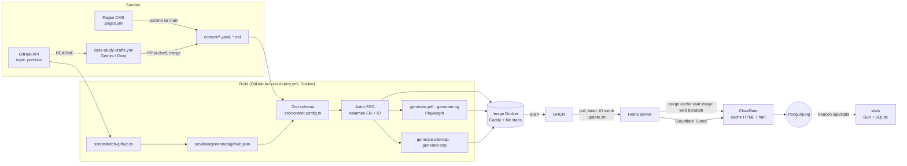

# 02 · Arsitektur

## 1. Gambaran besar



Prinsip utama:
1. **Statis terlebih dahulu.** Semua halaman di-render saat build dan disajikan Caddy. Proses aplikasi di runtime hanya dua layanan kecil: statistik + antrean kesan & pesan (`services/stats/`, ADR 0009, 0017) dan chatbot (`services/assistant/`, ADR 0014); jika keduanya mati, situs tetap utuh. Ini cepat, aman, dan cocok dengan cache CDN.
2. **Satu sumber data.** `content/` adalah satu-satunya tempat isi. Web, CV, dan Portfolio membaca data yang sama.
3. **Validasi saat build.** Data salah berarti build gagal, sehingga tidak pernah sampai ke production.
4. **3D adalah lapisan tambahan.** HTML statis sudah lengkap. Three.js hanya "menghias" jika perangkat mampu.

## 2. Tech stack

| Lapisan | Pilihan | Alasan (ADR) |
|---|---|---|
| Framework | Astro (SSG), TypeScript strict | 0001 |
| Runtime & package manager | Bun | 0001 |
| Styling | Tailwind CSS + CSS custom properties (tokens) | 0006 |
| 3D | Three.js vanilla, dimuat sebagai island | 0007 |
| Validasi data | Zod (Astro Content Layer) | 0002 |
| i18n | Routing bawaan Astro, `en` default | 0008 |
| PDF | Playwright mencetak halaman `/print/*` | 0003 |
| Statistik | Service kecil Bun + SQLite di domain yang sama | 0009 |
| Server web | Caddy (dalam image) | 0005 |
| CI/CD | GitHub Actions → GHCR → systemd timer (`docker compose pull`) | 0005, 0010 |
| Tes | `bun test` (unit), Playwright (e2e), axe (a11y) | – |
| Lint/format | ESLint + Prettier (dengan plugin Astro) | – |

Versi dikunci di `package.json`/`bun.lock`. Saat T1.1: Astro 7.3.5, TypeScript 6.0.3 (TS 7 belum didukung `@astrojs/check`), Node ≥ 22.12, Bun 1.3.

## 3. Lapisan dan arah dependensi

```
content/ (data)          ← tidak bergantung pada apa pun
   ↓
src/content.config.ts    ← skema Zod; satu-satunya yang tahu bentuk mentah data
   ↓
src/lib/**               ← logika murni (tanpa DOM, tanpa Astro API jika bisa), mudah dites
   ↓
src/components/**        ← presentasi (.astro), menerima data lewat props
   ↓
src/pages/**             ← komposisi: mengambil data via lib, merangkai komponen

src/scenes/**            ← modul 3D imperatif; hanya diimpor oleh <script> di komponen island, kecuali modul kecil yang murni dan tanpa three.js (mis. `core/early.ts` di BaseLayout, `room/parts/hero-config.ts` di HeroPrints)
```

Aturan:
- Panah hanya boleh ke bawah. `lib` tidak boleh mengimpor `components`; `components` tidak boleh mengimpor `pages`.
- `scenes` tidak boleh mengimpor `components` atau `astro:*`. Data masuk lewat parameter atau atribut `data-*`.
- Komponen tidak memanggil `getCollection` atau `queries` sendiri. **Halaman** mengambil data lewat `@/lib/content/queries` lalu meneruskannya lewat props (contoh: halaman → `PageLayout profile={…}` → `Footer`).
- Menu utama hanya berisi halaman yang sudah ada. Saat membuat halaman baru, tambahkan item ke `NAV_ITEMS` di `src/lib/navigation.ts` dan kunci labelnya di kamus UI.
- Helper murni diimpor dari `@/lib/content` (aman untuk unit test). `@/lib/content/queries` memakai `astro:content`, jadi **tidak** boleh diimpor oleh unit test atau oleh helper murni.
- **Astro mengembalikan entri collection terurut berdasarkan `id`, bukan urutan file.** Collection yang urutannya bermakna (journey, skills) memakai `parseYamlList(..., { withPosition: true })` lalu diurutkan dengan `position` di `queries.ts`.
- Fungsi yang bergantung pada waktu (mis. sertifikat kedaluwarsa) menerima `now: Date` sebagai parameter agar hasil build dan tes dapat direproduksi.

## 4. Struktur folder

```
.
├── content/                     # SUMBER DATA (lihat docs/04-content-guide.md)
│   ├── profile.yaml
│   ├── experience.yaml
│   ├── education.yaml
│   ├── awards.yaml
│   ├── trainings.yaml
│   ├── certifications.yaml
│   ├── skills.yaml
│   ├── journey.yaml
│   ├── cv-variants.yaml         # varian CV per posisi (Fase 10): memilih & mengurutkan isi
│   ├── messages.yaml            # kesan & pesan dari orang lain (T9.4); yang dari formulir masuk lewat PR (ADR 0017)
│   ├── github.yaml              # repo GitHub yang ditampilkan (include, topic, exclude)
│   ├── projects/*.md            # studi kasus; projects/id/*.md = body bahasa Indonesia (T9.3)
│   └── media/                   # foto & gambar yang dipakai konten
├── src/
│   ├── content.config.ts        # mendaftarkan collection + loader (skema diimpor dari lib/content/schemas)
│   ├── lib/
│   │   ├── content/             # schemas/ (Zod, murni), yaml.ts (parser), helper murni (localize, localizeNumber,
│   │   │                        #   cv-variants, …), queries (astro:content)
│   │   ├── navigation.ts        # NAV_ITEMS (menu utama) dan label platform sosial
│   │   ├── site.ts, downloads.ts # URL situs; nama file dan path unduhan PDF (CV umum, varian, Portfolio)
│   │   ├── theme.ts             # logika tema terang/gelap
│   │   ├── i18n/                # locales.ts, ui.ts (kamus), format.ts (fill), routing.ts (path per bahasa)
│   │   ├── github/              # schemas, select (murni), client (REST, retry), sync (I/O diinjeksi)
│   │   ├── stats/               # events (skema payload), privacy, beacon, summary (format laporan)
│   │   ├── security/            # csp.ts: hash script inline → header CSP
│   │   ├── seo/                 # og (nama gambar pratinjau), sitemap/robots, json-ld, html (baca HTML build) (murni); person.ts (khusus Astro)
│   │   ├── ai/                  # penyedia model bersama (Gemini, Groq): dipakai draf AI dan chatbot (ADR 0013, 0014, 0015)
│   │   ├── drafts/              # draf studi kasus AI: candidates, prompt, schema (pengaman), markdown, providers, run
│   │   └── assistant/           # chatbot (ADR 0014): knowledge (skema), sections + project-sections + text (konten → teks),
│   │                            #   budget (token, versi ringkas, cek path, PHONE_PATTERN), ask (permintaan, prompt,
│   │                            #   pemeriksa jawaban), limits (batas pemakaian), chat (sisi browser: obrolan per tab,
│   │                            #   body permintaan, membaca jawaban), eval (penilai uji T11.5); tanpa API Node
│   ├── components/
│   │   ├── layout/              # Header, Footer, LangSwitch, ThemeToggle, MobileMenu, SkipLink, StatsBeacon
│   │   ├── ui/                  # Icon, DownloadIcon, RichText (generik, tanpa domain)
│   │   ├── hero/                # Hero.astro, HeroPrints.astro (foto + lembar aksara; slot ruang)
│   │   ├── journey/             # Journey.astro (timeline HTML + island 3D), MilestoneDetail (dialog)
│   │   ├── projects/            # ProjectRow + ProjectIndex (baris indeks, beranda), ProjectCard + ProjectGrid (kartu, /projects/ sampai T15.1),
│   │   │                        #   ProjectFilter (cari + bidang), SelectedProjects
│   │   ├── about/               # AboutSection, TimelineItem
│   │   ├── messages/            # Messages (kesan & pesan di beranda + ajakan, T9.4), MessageForm (formulir, T12.2),
│   │   │                        #   MessageReview (antrean privat pemilik, T12.3)
│   │   ├── assistant/           # AskWidget (chatbot di sudut, T11.4) + ask-panel.ts (dimuat saat diklik)
│   │   ├── contact/             # Contact (bagian kontak beranda)
│   │   ├── room/                # RoomStage (kanvas tetap "satu ruang", ADR 0019), HomeRoom (stage + skrip beranda)
│   │   ├── stats/               # SiteStats, ServerStatus (halaman /stats/)
│   │   └── print/               # CvDocument, CvEntry, PortfolioDocument
│   ├── scenes/
│   │   ├── core/                # capabilities (WebGL, hemat data, reduced motion), early (keputusan 3D di <head>),
│   │   │                        #   mount, loop, dispose, math, palette, pointer, types (kontrak SceneModule)
│   │   ├── room/                # "satu ruang" (ADR 0019, 0020): world (koordinat dunia, stasiun), camera (kunci kamera,
│   │   │                        #   murni), layout (isNear), index (createRoom, mountRoom), paper (label, kotak deteksi,
│   │   │                        #   bayangan lembut, font label), parts/hero (+ hero-config), parts/journey,
│   │   │                        #   parts/sorting (+ sorting-plan, murni), parts/notes, parts/laptop
│   ├── layouts/                 # BaseLayout (dokumen, head, SEO, hreflang, tema) · PageLayout (skip link, header, main, footer)
│   │                            #   · PrintLayout (halaman cetak PDF)
│   ├── pages/
│   │   ├── [...locale]/         # SATU file per halaman untuk semua bahasa (lihat §7)
│   │   │   ├── index.astro, about.astro, stats.astro
│   │   │   ├── projects/index.astro, projects/[slug].astro
│   │   │   ├── messages/index.astro (formulir), messages/sent.astro, messages/not-sent.astro (noindex),
│   │   │   │   messages/review.astro (tinjau privat ber-token, noindex, tanpa statistik)
│   │   │   └── print/cv.astro, print/cv/[variant].astro, print/portfolio.astro; cv.astro (daftar CV per posisi)
│   │   ├── 404.astro, robots.txt.ts, assistant-knowledge.json.ts (sumber pengetahuan chatbot, hanya saat build)
│   │   └── og-template.astro    # templat gambar pratinjau (dipotret saat build)
│   ├── styles/                  # tokens.css, global.css
│   └── data/generated/          # output script build (di-gitignore)
├── services/stats/              # service statistik (Bun + bun:sqlite): store, handler, server; juga antrean kesan & pesan
│                                #   (messages, messages-store: messages.sqlite terpisah, token, ADR 0017)
├── services/assistant/          # chatbot "Tanya Harry" (Bun, tanpa penyimpanan): handler (POST /api/ask, health),
│                                #   routes (penyedia + pengetahuan, dipakai juga uji), server
├── scripts/                     # fetch-github, generate-pdf, generate-og, generate-sitemap, generate-knowledge, generate-csp, precompress,
│                                #   serve-build, lighthouse-summary, draft-case-studies, stats-report, check-tokens,
│                                #   assistant-eval (uji chatbot T11.5); kind-words (PR + notifikasi kesan & pesan, T12.4);
│                                #   lib/static-server.ts (server build untuk Chromium), lib/compression.ts
├── tests/
│   ├── unit/                    # cermin struktur src/lib
│   ├── e2e/                     # Playwright: halaman, i18n, 3D, unduhan, a11y (axe), SEO, deployment
│   └── eval/                    # assistant-cases.yaml: pertanyaan uji chatbot dengan model sungguhan (T11.5)
├── docker/                      # Dockerfile, Caddyfile, compose.yml, compose.dev.yml, deploy/ (timer, update, backup)
├── .pages.yml                   # editor browser Pages CMS untuk content/ (ADR 0011)
└── .github/workflows/           # ci.yml, deploy.yml, case-study-drafts.yml, assistant-eval.yml (§5)
```

## 5. Alur build

```
bun run build
  1. scripts/fetch-github.ts     → src/data/generated/github.json
                                   REST API, token opsional; repo dipilih lewat content/github.yaml;
                                   cache < 1 jam dipakai ulang; gagal → cache terakhir → daftar kosong;
                                   e2e terisolasi: GITHUB_FIXTURE=tests/fixtures/github.json,
                                   GITHUB_CACHE=…/github.e2e.json, output dist-e2e/ (tidak menyentuh dist/)
  2. astro build                 → dist/  (validasi Zod terjadi di sini)
  3. scripts/generate-pdf.ts     → <outDir>/downloads/*.pdf + downloads/cv/*.pdf (varian CV, didaftar di /cv/) (Bun.serve + Chromium, cetak /print/*; anggaran ukuran)
  4. scripts/generate-og.ts      → <outDir>/og/*.jpg (template /og-template/ + Chromium, 1200×630, ≤ 150 KB)
  5. scripts/generate-sitemap.ts → <outDir>/sitemap.xml (dari canonical + hreflang tiap halaman; noindex dilewati)
  6. scripts/generate-knowledge.ts → build-meta/knowledge.json (lengkap, EN+ID; isi studi kasus EN, ADR 0022) + knowledge-compact.json (EN, ≤ 5 ribu token)
                                   untuk chatbot (ADR 0014): dari endpoint build /assistant-knowledge.json (query yang sama
                                   dengan halaman), path dicek terhadap output, gagal jika tautan mati, nomor HP, atau melebihi
                                   anggaran token; endpoint dihapus dari output
  7. scripts/generate-csp.ts     → build-meta/csp.caddy (hash setiap script inline; gagal jika ada font data:)
  Hanya di Docker: scripts/precompress.ts → salinan .br/.gz di samping file teks (docs/07 §4)
  BUILD_OUT_DIR mengganti folder output (Astro dan skrip PDF membaca variabel yang sama)
```

**Workflow GitHub Actions** (detail: [07 Deployment](07-deployment.md), [10 Operasional](10-operations.md)):

| Workflow | Pemicu | Isi |
|---|---|---|
| `ci.yml` (*CI*) | Pull request; dipanggil `deploy.yml` | `bun run verify` (check → unit → e2e), Lighthouse CI + ringkasan anotasi |
| `deploy.yml` (*Deploy*) | Push ke `main`, jadwal `17 */6 * * *` (UTC), manual | `ci.yml` → build image `web` + `stats` → push ke GHCR (`latest`, `sha-<commit>`) |
| `kind-words.yml` (*Kind words*) | Tiap jam (`publish`) dan 08.07 WIB (`notify`), manual | Pesan yang disetujui → AI editor (bahasa tulisan, metadata dirapikan, terjemahan, saran, tanda; ADR 0023) → satu PR antrean berisi tabel laporan (`kind-words/queue`) → dihapus dari server; jumlah pesan menunggu → issue (email GitHub), tanpa isi pesan (T12.4, ADR 0017) |
| `assistant-eval.yml` (*Assistant eval*) | Manual saja | Build + ±30 pertanyaan uji ke chatbot dengan model sungguhan → laporan di ringkasan run (T11.5, `docs/assistant-eval.md`) |
| `case-study-drafts.yml` (*Case study drafts*) | Jadwal `41 2,14 * * *` (UTC, dua kali sehari), manual | `bun run drafts`: draf studi kasus AI → satu PR per proyek, grup repo = satu proyek (ADR 0013, 0016) |

**Sesudah image tayang di GHCR** (server, `docker/deploy/`): `portfolio-update.timer` (2 menit setelah boot, lalu tiap 10 menit) → `update.sh`: `docker compose pull` → `up -d --wait` → jika image `web` berubah, hapus cache Cloudflare untuk hostname situs (ADR 0010, 0012). Dari commit sampai tayang ±20 menit.

## 6. Kontrak modul 3D

Semua scene memakai `src/scenes/core/` (T2.1). Scene konkret hanya membangun objek dan menganimasikannya; urusan umum ditangani `mountScene`.

```ts
// src/scenes/core/mount.ts: dipanggil dari <script> komponen island
const handle = mountScene({ stage, canvas, create: createRoom(parts, shadows) }); // SceneHandle | null
handle?.destroy(); // aman dipanggil dua kali

// Scene konkret (sejak Fase 13 hanya ruang, src/scenes/room/index.ts) mengembalikan SceneModule:
interface SceneModule {
  scene: Scene; camera: Camera;
  update(frame: { dt; elapsed; pointer: { x; y } }): void; // dt sudah dijepit [0, 0.05]
  resize(width: number, height: number): void;
  dispose?(): void; // listener/timer/canvas texture; geometry & material dibersihkan otomatis
  needsRender?(): boolean; // opsional: false = frame ini tidak berubah, render dilewati (ADR 0019)
}
// create(setup) menerima { palette, renderer, mode: 'animated' | 'still', invalidate, ready }
```

`mountScene` menangani:
- **Keputusan 3D** (`decide3D`, murni): `off` tanpa WebGL, dengan Save-Data, atau CPU ≤ 2 core → mengembalikan `null` dan HTML fallback tetap tampil; `still` untuk `prefers-reduced-motion` (satu frame diam); selain itu `animated`. Status ditulis ke `stage.dataset.scene` (`animated`/`still`/`off`) untuk CSS dan tes.
- Renderer (`alpha`, DPR maksimal 2), ukuran mengikuti `stage` (`ResizeObserver`), pointer ternormalisasi -1..1, loop yang **berhenti saat stage tidak terlihat** (`IntersectionObserver`), dan error per frame yang dilaporkan tanpa menghentikan loop.
- Warna dari token CSS (`readPalette`), tidak pernah ditulis di kode scene.
- `destroy()`: hentikan loop, lepas observer/listener, `disposeObject3D(scene)`, `renderer.dispose()`.

Pelajaran dari prototipe: `dt` negatif pada frame pertama pernah merusak animasi; `frameDelta` kini selalu menjepitnya dan dites.

### 6.1 "Satu ruang" (ADR 0019, 0020; Fase 13–14)

Beranda (dan nanti halaman lain) memakai **satu** kanvas `position: fixed` di belakang `main` (`src/components/room/RoomStage.astro`), dipasang dengan `mountRoom(stage, parts, decision?)` dari `src/scenes/room/` lewat `mountScene` yang sama. Sejak ADR 0020 benda 3D **tidak lagi ditambatkan ke HTML**: setiap bagian berdiri di stasiun tetap di dunia (`world.ts`), dan kamera bergerak di antara stasiun mengikuti scroll.

```ts
// src/scenes/room/index.ts
interface RoomPart {
  slot: HTMLElement;                         // elemen HTML yang memegang data dan fallback bagian itu
  build(room): Object3D | Promise<Object3D>; // sekali, saat slot mendekati layar (BUILD_MARGIN); root sudah di stasiunnya
  layout?(room): void;                       // layar berubah (ukuran, lebar/sempit): setelah build dan tiap resize
  update?(frame): boolean;                   // true selama masih bergerak; frame.keys = posisi kamera di antara kunci
  recolor?(palette): void;                   // tema berganti
  shown?(): void;                            // root sudah di scene; tergambar mulai frame berikutnya
  targets?(): RoomTarget[];                  // objek yang bisa diklik/di-hover (wajib punya padanan HTML)
  dispose?(): void;
}
```

- **Dunia** (`world.ts`, satuan dunia, meniru artifact yang disetujui): dinding di `WALL_Z` (hero, journey) dan lantai di `FLOOR_Y` (konveyor, kertas Kind words, laptop), keduanya `ShadowMaterial` yang hanya menangkap bayangan (warna ruangan tetap latar CSS; hanya digambar bila ada peta bayangan). `STATIONS` memberi posisi setiap bagian. Bagian lama tetap memakai ukuran "piksel desain" Fase 13 dan menskalakan root-nya (`DESIGN_UNIT`, konveyor dengan skala sendiri).
- **Kamera** (`camera.ts`, murni dan dites): satu kunci per ruang (`hero`, `journeyStart`, `journeyEnd`, `projects`, `messages`, `contact`): target, arah, jarak minimum, lebar dunia yang harus muat, dan offset tampilan (`setViewOffset`) agar subjek di kanan kolom teks (layar ≥ `WIDE_MIN` 1024 px) atau di atas panel (HP). `stopsFor` menghitung posisi scroll setiap kunci dari `[data-room-section]` (hero di atas, journey dari sebelum bagiannya sampai akhirnya, ruang lain saat bagiannya di tengah layar, atau saat tepi atasnya sampai di atas layar bila bagian itu lebih tinggi dari layar; bagian yang tidak ada dilewati); `trackAt` + `poseAt` menginterpolasi (smoothstep) di antara dua kunci; `keyPosition` memberi posisi kontinu (0–5) yang diikuti bagian (bola journey, konveyor hanya jalan dan tampil dekat kuncinya). Paralaks pointer kecil hanya di mode `animated`. Di mode `still` (reduced motion) kamera tidak melayang: posisinya dibulatkan ke kunci terdekat, jadi pemandangan berganti dengan potongan.
- **Cahaya**: matahari (`DirectionalLight`) dan target bayangannya mengikuti target kamera (`SUN.offset`, jangkauan ±12), `HemisphereLight` tetap; warnanya dari `--room-sun/-sky/-ground`. Dengan pointer halus (mouse/pen) di mode `animated`, matahari bergeser pelan ke arah kursor (`SUN_FOLLOW`). `RoomContext.setLight(level)` menskalakan kedua cahaya (0–1): dipakai pembuka hero (ruangan redup → lampu menyala). Peta bayangan hanya bila `realtimeShadows` (≥ 6 core dan bukan layar sentuh); tanpa itu bagian menggambar bayangan lembut (`paper.ts`).
- **Warna dinding mengikuti kamera**: `flowAt` (0–1, 40 langkah) → `wallColors` menulis `--room-a/b/c` di `body` sebagai `color-mix()` dari token ruangan sepanjang jalur `room-top → room-mid → room-bottom` (jalur yang sama dengan yang dites kontrasnya), hanya saat langkahnya berubah. Di mode ruangan latar `body` dipaku ke layar (`background-attachment: fixed`) dan mulai dari ujung giok sebelum frame pertama. Safari iOS mengabaikan `fixed` sehingga gradasinya membentang sepanjang halaman; karena a, b, dan c hanya berjarak 12% jalur, hasilnya tetap halus.
- **Stage**: `RoomStage.astro` setinggi `100lvh` (toolbar HP tidak mengubah skala) dan tidak boleh berada di dalam elemen ber-`transform`/`filter`/`contain`/`isolation`.
- **Bagian**: dibangun saat slotnya dekat, satu per satu dan setiap langkah di tugasnya sendiri (`yieldToMain`, `src/scenes/core/yield.ts`): membangun, mengompilasi shader async (`compileAsync`), lalu mengunggah teksturnya satu per satu (`renderer.initTexture`), baru ditambahkan ke scene; bagian yang selesai setelah `destroy()` dibuang. Gambar hero didekode di luar thread utama (`ImageBitmapLoader`, dengan cadangan `TextureLoader`). Dengan begitu tidak ada tugas panjang saat ruangan masuk (Lighthouse HP dengan GPU 90–91, T14.5). Posisi kunci kamera dihitung ulang saat resize dan saat ukuran `body` berubah.
- **Render sesuai kebutuhan**: `needsRender()` true bila scroll (kamera bergerak), pointer, tema, atau `update()` sebuah bagian berubah. Bagian yang beranimasi terus (konveyor) hanya maju selama kamera dekat kuncinya.
- **Klik dan hover**: klik di luar elemen interaktif HTML di-raycast ke `targets()` lewat kamera yang sedang bergerak, kecuali bila pointer bergeser > 5 px atau ada teks terpilih; `onClick(event, pointerType)` menerima jenis pointer saat ditekan; objek yang tersembunyi (sendiri atau lewat induknya, mis. bagian yang hanya tampil dekat ruangnya) tidak bisa diklik atau di-hover (konveyor: ketuk pertama di layar sentuh menampilkan judul, ketuk kedua membuka studi kasus). `onHover(true/false)` saat mouse masuk/keluar objek; `html.room-hover` memberi kursor tangan (mouse saja). `RoomContext.toScreen` memberi posisi layar sebuah titik dunia (dipakai untuk `data-detected-at` konveyor dan `data-bead-at` journey, yang dibaca tes).
- **Keputusan 3D sebelum tampilan pertama** (ADR 0020): beranda memakai `earlyRoom` di `PageLayout`/`BaseLayout`, yang menyisipkan skrip inline di `<head>` dari `earlyRoomScript()` (`src/scenes/core/early.ts`). Fungsi `earlyMode` di sana adalah salinan mandiri dari `decide3D(detectCapabilities())` (sumbernya disisipkan dengan `toString()`, jadi tidak boleh memakai apa pun dari luar); tes unit memastikan keduanya sama untuk setiap kombinasi masukan (termasuk ambang core, semua pola renderer CPU, dan storage/WebGL yang melempar galat), jadi setiap perubahan di `capabilities.ts` harus diulang di `early.ts`. Hasilnya `html[data-room-3d="animated|still"]` sudah ada sebelum halaman tergambar. Keputusan ini berlaku penuh: `HomeRoom.astro` membacanya dengan `earlyDecision()` dan meneruskannya ke `mountRoom` (WebGL tidak diperiksa dua kali); tanpa atribut (skrip diblokir atau gagal) ruangan tidak dipasang. Atribut dicabut bila `mountRoom` gagal atau chunk 3D gagal dimuat. Hash CSP skrip ini dibuat otomatis oleh `scripts/generate-csp.ts`. Anggaran JS 3D beranda (≤ 180 KB gzip, docs/03 §6) dijaga tes e2e `home-room.spec.ts` (skrip yang hanya dimuat saat ruangan jalan); pergeseran tata letak sepanjang umur halaman (hero sampai ruang Proyek) juga dites < 0,01.
- **Tata letak ruangan** (hanya di bawah `html[data-room-3d]`, `global.css` dan gaya tiap bagian): setiap `[data-room-section]` beranda (hero, journey, projects, messages, contact) selayar penuh tanpa garis pemisah (garis header dan garis atas bagian dihilangkan dengan aturan di luar `@layer`, agar mengalahkan utilitas `border-line`); `[data-room-copy]` adalah blok teks bagian itu, di kolom kiri di atas `.room-scrim` (layar ≥ 64rem, dari `HomeRoom.astro`) atau di panel `surface` 92% di bawah 3D-nya (layar < 64rem: cetakan hero pindah ke atas; bagian lain diberi padding atas 48svh untuk 3D). Ruang tombol "Play again" disediakan sejak awal (hanya mode `animated`) agar teks hero di HP tidak melompat. `.room-dark` (di belakang kanvas) meredupkan dinding selama pembuka hero. Kamera memilih bingkai lebar/sempit dengan media query yang sama dengan CSS (`WIDE_QUERY`), karena kanvas lebih sempit selebar scrollbar.
- **Pita data 3D** (`data-room-band`: konveyor di Proyek pilihan, laptop di Kontak): `display: none` kecuali `html[data-room-3d]`; isinya data bagian 3D (dan keterangan laptop), bukan tempat 3D-nya. Pita konveyor tingginya 0; pita laptop hanya memuat keterangan. Sebelum bagiannya tergambar (`data-room-ready`) pita tidak terlihat.
- **Target diperbarui**: `targets()` dibaca ulang setelah build, layout, resize, dan recolor, karena bagian boleh mengganti objeknya (konveyor membangun ulang kartu untuk lebar dan tema baru). Hover diperiksa ulang setiap frame selama ada bagian yang bergerak sendiri.
- **Bagian beranda** (urutan halaman): `hero` (cetakan foto + aksara digantung dengan jepitan di dinding, skala `HERO_UNIT`; posisi dari `hero-config.ts` lewat `printLayout`, sama dengan HTML-nya; kertas bertekstur serat (`paperFibers` sebagai `bumpMap`) dan bayangan kontak lembut; lampu gantung dan pembuka `lampAt`: sekali, hanya bila ruangan mulai di atas halaman dan mode `animated`: redup, lampu berkedip lalu menyala, baru deteksi; `data-lamp` = `off`/`on`), `journey` (satu benang `CatmullRom`: tali jemuran dari paku kiri lewat jepitan foto dan lembar aksara (`heroPins`) ke paku kanan (`clotheslineNails`), lalu turun di dinding lewat satu titik per milestone (`beadPositions`), lalu menyeberang lantai ke konveyor; bola menunggu di paku kanan lalu mengikuti `keyPosition` lewat `ballAt`; titik yang dilewati menyala dan item HTML-nya `data-reached`), `sorting` (konveyor di lantai, wadah di belakang sabuk dan pendorong di depannya: kartu dan wadah dari atribut data `SelectedProjects.astro`, yang memilihnya dengan `sortingLine()` dari `content/`; kartu yang terdeteksi menandai baris proyek yang sama (`data-detected`, bila ada barisnya) dan mengisi log `[data-detection-log]` "Judul → Bidang"; linimasa murni di `sorting-plan.ts`; geometri Fase 13 diputar sebesar sudut pandang kamera sehingga sabuk rebah di lantai; tampil dan jalan hanya dekat kunci `projects` karena labelnya selalu di atas), `notes` (maks. `MAX_NOTES` kertas Kind words ditempel di dinding pendek penangkap bayangan yang berdiri di lantai, baris dari lantai ke atas (`notePosition`), masing-masing tanda kutip dan nama penulis dari HTML-nya; isi pesan hanya di HTML; tampil hanya dekat kunci `messages`), `laptop` (di lantai; layar digambar dengan canvas: beranda mini dari atribut data pita laptop di `Contact.astro` (nama, baris peran, label CV) dan foto tekstur hero, plus baris status `statusLine` dari `/api/health` dan `/api/stats/summary` (hanya bila `PUBLIC_STATS_ENABLED`; `visitorsOf` membaca angka 30 hari tanpa zod agar bundel 3D tetap kecil); `data-screen-status` untuk tes).
- **Tema**: `MutationObserver` pada `data-theme` dan `prefers-color-scheme` membaca ulang palet dan memanggil `recolor`.

## 7. i18n

- Locale: `en` (default, tanpa prefix) dan `id` (`/id/`). Konstanta di `src/lib/i18n/locales.ts`.
- **Pola halaman:** setiap halaman ada di `src/pages/[...locale]/` dan memakai `export const getStaticPaths = localeStaticPaths;`. Parameter `locale` kosong menghasilkan halaman EN tanpa prefix, `id` menghasilkan `/id/…`. Locale masuk lewat `Astro.props.locale`. Halaman dengan parameter lain (mis. `[slug]`) menggabungkan `localeStaticPaths()` dengan daftar slug.
- **URL:** jangan menulis path manual. Gunakan `localizePath(path, locale)` dan `alternates(pathname)` dari `@/lib/i18n` (semua path diakhiri `/`).
- `BaseLayout` otomatis menulis `<html lang>`, canonical, dan `hreflang` (`en`, `id`, `x-default`).
- Teks konten memakai tipe `LocalizedText = { en: string; id?: string }`. Helper `localize(text, locale)` mengembalikan `id` jika ada, jika tidak `en`.
- Angka yang ditulis sekali untuk dua bahasa (`value` di `stats`/`metrics`, `gpa`) ditulis gaya Inggris dan ditampilkan lewat `localizeNumber(value, locale)`: `92.5%` → `92,5%` di halaman dan PDF Indonesia (D16, T9.5).
- Body studi kasus bahasa Indonesia ada di `content/projects/id/<slug>.md`; bila belum ada, halaman `id` memakai body Inggris dengan catatan (T9.3).
- Teks UI ada di `src/lib/i18n/ui.ts` sebagai kamus bertipe, sehingga kunci yang hilang menjadi error TypeScript.

## 8. Keamanan

- Tidak ada secret di klien. `GITHUB_TOKEN` hanya dipakai saat build.
- Header keamanan diatur di `docker/Caddyfile` (CSP ketat, HSTS, `X-Content-Type-Options`, `Referrer-Policy`, `Permissions-Policy`).
- Tidak ada script pihak ketiga. Statistik memakai endpoint di domain sendiri (`/api/stats/*`).
